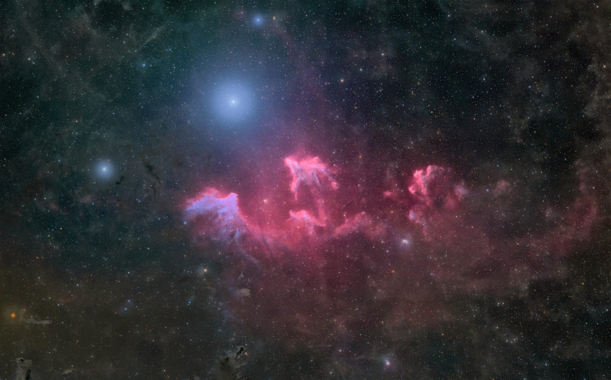
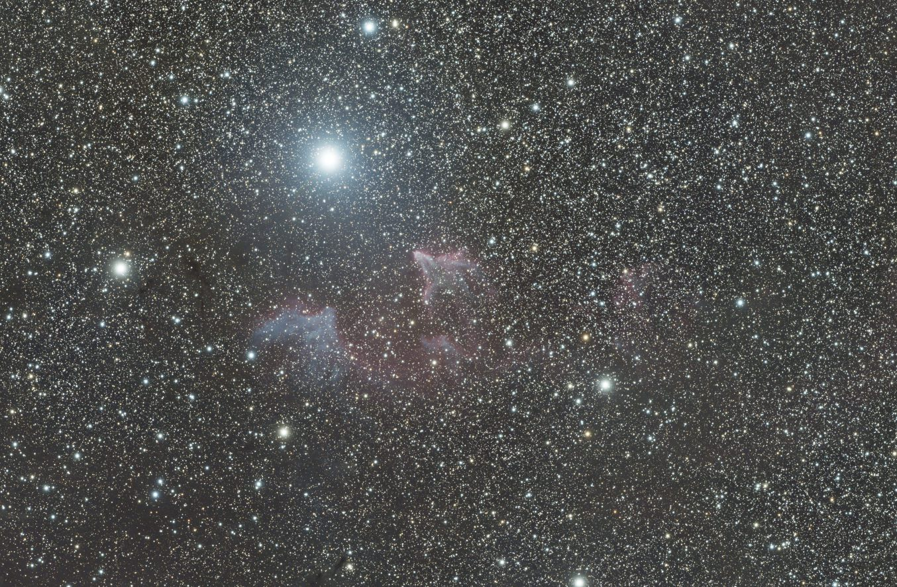
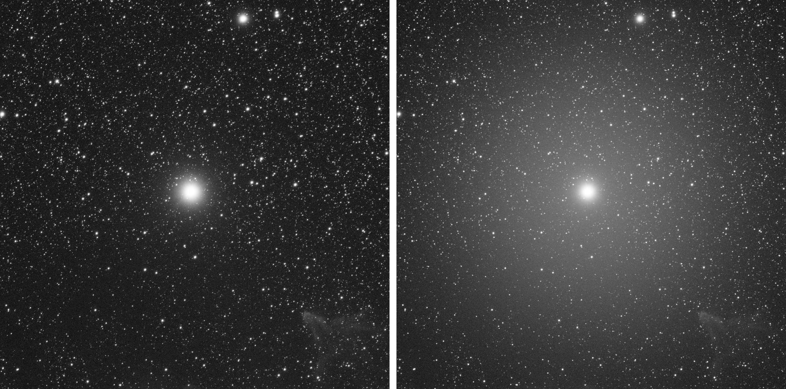
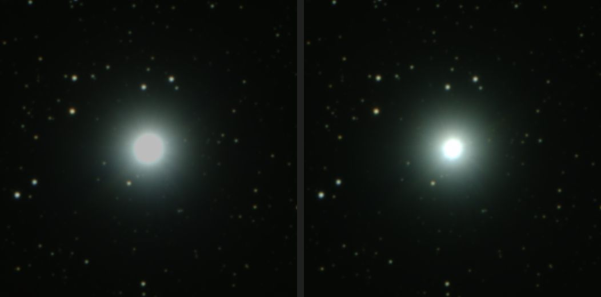
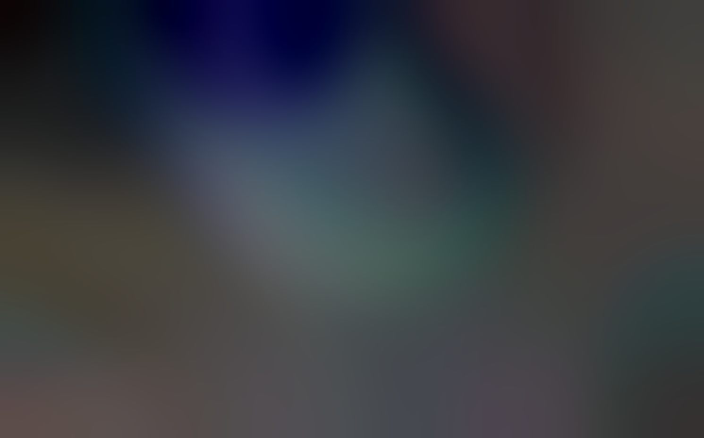

# Caso práctico: IC 63, el Fantasma de Cassiopeia

IC 63 es una nebulosa mixta (emisión Hα y reflexión azul) a muy poca distancia angular de **γ Cassiopeiae**, una estrella de magnitud ~2,5. Es un objeto difícil por tres motivos: la estrella satura el sensor y llena el campo de halos, la nebulosa combina luz de emisión y de reflexión, y los datos se tomaron bajo **cielo urbano**, con gradientes fuertes.

Este caso resume cómo se procesó con el agente y la guía de este repositorio, qué se midió en cada paso y qué no funcionó. Las imágenes son JPG reducidos; los datos originales no se publican.

*Resultado final (versión 4B).*

## Datos

| | Tomadas | Usadas | Tiempo útil |
|---|---|---|---|
| RGB sin filtro, 120 s | 330 | 261 | ~8,7 h |
| RGB sin filtro, 30 s | 49 | 47 | ~24 min |
| Dual band Hα/OIII 5 nm, 180 s | ~247 | ~205 | ~10 h |

Equipo: refractor de 106 mm a f/4,8 y cámara OSC con sensor IMX571, masters con drizzle 2x. Seis noches, del 8 al 13 de octubre de 2026.

*Master RGB de 120 s con un estirado automático, antes de procesar: gradiente de contaminación lumínica y γ Cas dominando el campo.*

## 1. Selección de subs: buscar las nubes finas

Las métricas habituales (FWHM, excentricidad, número de estrellas) no detectan bien las nubes finas o la calima, que forman halos alrededor de las estrellas brillantes. Si esos subs entran en la integración, el halo queda en el master y ya no hay forma limpia de quitarlo.

Se midió un **índice de halo** en cada sub: el brillo de un anillo alrededor de γ Cas, menos el fondo lejano, dividido por el flujo de la estrella. Comparado entre subs y a lo largo de la noche, separa claramente los subs limpios de los afectados. Se descartaron **69 subs RGB de 120 s y 42 de banda estrecha**.

*Mismo recorte y mismo estirado en un sub limpio (izquierda) y en uno con nube fina (derecha): el halo difuso es lo que el índice detecta.*

Técnica: [`guia/referencia/02-preprocesado.md`](../../../guia/referencia/02-preprocesado.md) (índice de halo por sub).

## 2. HDR con tomas cortas para γ Cas

Con 120 s el núcleo de γ Cas está saturado: pierde forma y color, y cualquier procesado posterior trabaja sobre una meseta plana. Por eso, además de la RGB larga, se tomaron subs de **30 s**. Se combinaron en lineal con **HDRComposition** (umbral de binarización 0,80, suavizado 7, crecimiento 1). El factor entre exposiciones medido en estrellas no saturadas fue de 3,66–3,93, coherente con el teórico de 4.

*Mismo recorte y **mismo estirado** en la RGB de 120 s (izquierda) y en la HDR 120 s + 30 s (derecha), igualadas en la zona no saturada. En la larga el núcleo es una meseta gris uniforme; en la HDR sigue habiendo estructura hasta el blanco.*

Perfil radial medio (1,0 = nivel de saturación de la toma de 120 s):

| Radio | RGB 120 s | HDR 120 s + 30 s |
|---|---|---|
| 0–10 px | 1,00 (saturado) | 4,67 |
| 10–20 px | 1,00 (saturado) | 3,51 |
| 20–30 px | 0,84 | 0,94 |
| 30–40 px | 0,34 | 0,34 |
| 60–70 px | 0,053 | 0,053 |

Los píxeles del núcleo por encima de 0,9 pasaron de unos 2300 a unos 790. Fuera de los 30 px las dos imágenes coinciden: la HDR sólo sustituye lo que estaba saturado.

Lección: la diferencia **no se ve en previsualizaciones estiradas** de cada imagen por separado, porque el estirado satura el disco en las dos. Hay que compararlas en lineal, con el mismo estirado.

Técnica: [`guia/referencia/03-hdr-tomas-cortas.md`](../../../guia/referencia/03-hdr-tomas-cortas.md).

## 3. Gradiente de cielo urbano

El gradiente se corrigió con **MGC (MARS)** antes de calibrar el color con SPCC. La prueba de que la corrección no se ha comido nebulosa real es el propio modelo: debe ser liso y no contener la forma del objeto.

*Modelo de gradiente restado: suave, sin rastro de la nebulosa.*

Técnica: [`guia/referencia/07-mars-mgc.md`](../../../guia/referencia/07-mars-mgc.md).

## 4. Hα del dual band y sustracción de continuo

El Hα se extrajo del master dual band con la **emulación de DBXtract por PixelMath** (coeficientes de QE del IMX571), porque el script no se puede lanzar desde el watcher. Como IC 63 tiene mucha luz de reflexión, el filtro también deja pasar continuo; se restó con el canal R de la HDR calibrada, con un factor **k = 0,332** medido como mediana sobre 3000 estrellas. El "OIII" del dual band en esta nebulosa es sobre todo continuo de reflexión, y no se interpretó como emisión.

Técnica: [`guia/referencia/05-flujos-astro-photographie.md`](../../../guia/referencia/05-flujos-astro-photographie.md) (DBXtract y continuo).

## 5. Estrellas y restos de estrellas brillantes

Las estrellas se separaron en lineal con StarXTerminator y salen de la RGB HDR, nunca del Hα. StarXTerminator deja un borde en el disco de las estrellas muy brillantes: en γ Cas y otras dos se rellenó la capa sin estrellas con la **continuación de su propio perfil radial medido** (ley de potencias), en vez de con un círculo plano.

Técnica: [`guia/referencia/08-estrellas.md`](../../../guia/referencia/08-estrellas.md) y [`guia/referencia/09-halos-estrellas-brillantes.md`](../../../guia/referencia/09-halos-estrellas-brillantes.md).

## 6. Combinación y acabado

Hα y RGB sin estrellas se estiraron por separado y se combinaron en no lineal; el polvo y los cirros se realzaron con LocalHistogramEqualization de radio grande bajo una máscara de fondo; el ruido se trató con NoiseXTerminator en varias pasadas suaves, y las estrellas se reincorporaron por *screen*.

Técnica: [`guia/referencia/11-combinacion-ha-oiii-rgb.md`](../../../guia/referencia/11-combinacion-ha-oiii-rgb.md).

## Lo que no funcionó

- **Rellenar el centro de γ Cas con un círculo plano**: borraba fondo real y dejaba una mancha visible.
- **Restar el halo con el perfil radial medido sin suavizar**: dejaba ondas concéntricas. Hubo que ajustar el perfil con una curva suave y quitar sólo el rizado residual.
- **Juzgar la HDR en previsualizaciones estiradas por separado**: parecía que no aportaba nada (ver el paso 2).

## Cómo se trabajó

Todo el procesado se hizo en sesiones de conversación con Claude, que controlaba PixInsight a través del watcher de este repositorio. El autor decidía en cada paso y elegía entre variantes; Claude ejecutaba, medía (perfiles, índices, estadísticas por zonas) y documentaba. Las lecciones de este caso se incorporaron después a la guía.
